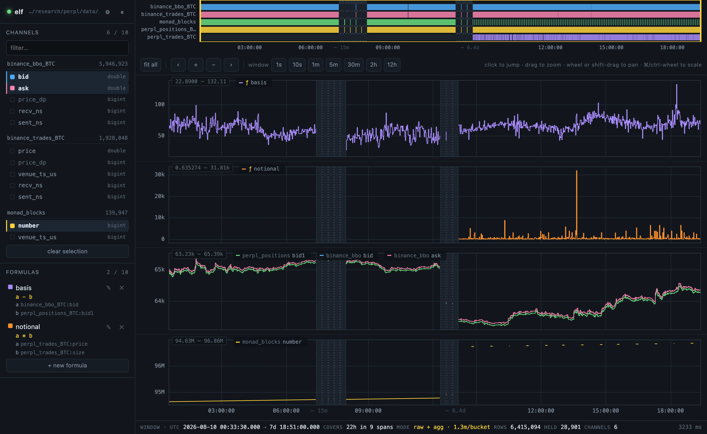

# elf

A multi-channel viewer for the raw parquet time-series store that `orc` writes.

A Rust server queries the parquet files in place and a React page draws them.
There is no import step, no derived dataset, no cache on disk — every pixel
comes from `series/**/*.parquet` at request time.



## Requirements

- Rust (stable or nightly)
- `brew install duckdb` — the server links against the system `libduckdb`
  rather than compiling DuckDB from source, which the `bundled` feature would
  spend about fifteen minutes doing.

Point the build at it with a `.cargo/config.toml`. It is not in the repo,
because it names a Homebrew prefix that is wrong on Intel Macs and on Linux:

```toml
[env]
DUCKDB_LIB_DIR = "/opt/homebrew/opt/duckdb/lib"
DUCKDB_INCLUDE_DIR = "/opt/homebrew/opt/duckdb/include"
```

`brew --prefix duckdb` prints the right root if yours differs. Without this the
build fails while linking, not while compiling.

No Node, no npm, no bundler. React and htm are vendored under `web/vendor/`
and served as plain files.

## Run

```sh
cargo run -- --data /path/to/data
# http://127.0.0.1:8787
```

| Flag             | Default           | Meaning                                             |
|:-----------------|:------------------|:----------------------------------------------------|
| `--data`         | *required*        | orc data dir, holding `manifest.json` and `series/` |
| `--web`          | `<crate dir>/web` | Static assets                                       |
| `--host`         | `127.0.0.1`       | Listen address                                      |
| `--port`         | `8787`            | Listen port                                         |
| `--max-channels` | `10`              | Channels one request may name                       |

`--data` has no default: the viewer is not tied to one store, and silently
opening someone else's is worse than saying nothing was named.

## What it does

**Picking a time, gaps skipped.** The store is a few bursts of recording
separated by gaps up to a week long. The axis maps wall-clock time onto units
where every covered span keeps its true duration and every gap is squeezed to a
fixed sliver, labelled with what it swallowed (`⋯ 6.4d`). The strip at the top
shows coverage for each series a selected channel belongs to — only the time
axis when nothing is selected. With several series, its `▾ N series` toggle
folds it to a single lane, with a picker for which series that lane shows.

| Gesture             | Coverage strip           | Charts                              |
|:--------------------|:-------------------------|:------------------------------------|
| Click               | Move the window there    | —                                   |
| Click a channel     | —                        | Adds it to a chart, or takes it off |
| Click a line        | —                        | Hides that line                     |
| Click a legend item | —                        | Hides that line, or brings it back  |
| Drag                | Select a new window      | Zoom to selection                   |
| Drag inside         | Move the window          | —                                   |
| Drag an edge        | Resize the window        | —                                   |
| Shift-drag          | —                        | Pan                                 |
| Wheel               | Pan                      | Pan                                 |
| Cmd/ctrl-wheel      | Zoom about the cursor    | Zoom about the cursor               |
| Double-click        | Fit the whole store      | Zoom out                            |
| Hover               | —                        | Crosshair, values in each legend    |

Clicking the strip keeps the window's span and takes it to where you clicked,
so moving a 30-second window across a week is one gesture rather than a scroll.
A press only counts as a click if the pointer did not travel, so drag-to-select
still works from anywhere on the strip. Panning against either end slides the
window up to the edge and stops, rather than squashing it.

**Channels.** Every numeric column of every series is listed; click one to put
it on a chart, click again to drop it. Selected rows carry the line's own
colour. Ten can be up at once, after which the rest grey out.

Clicking a drawn line — or its legend entry — hides it without unloading it:
the data stays in the page, the chart keeps its place in the stack, and the
y-axis rescales around whatever is left, which is usually why you hid it. The
legend entry, struck through, brings it back. A click only counts as a pick if
the pointer did not move, so dragging to zoom still works everywhere including
on top of a line.

**Formulas.** A formula is a channel the store does not contain, computed in
the page and drawn like any other — same colours, same legend, same hover
readout, marked `ƒ`. Inputs are bound to short names, so an expression reads
`a - b` rather than repeating `binance_bbo_BTC:bid`. Pick each input by typing
fragments of its name (`bbo bid`); every fragment has to appear, in any order.

Formulas take the top of the chart stack, and are grouped among themselves
rather than mixed into the real channels — a spread is rarely wanted overlaid
on the prices it came from.

| Written            | Meaning                                                     |
|:-------------------|:------------------------------------------------------------|
| `a - b`            | Difference between the two inputs                           |
| `(a + b) / 2`      | Mid                                                         |
| `(b - a) / a * 1e4`| Spread in basis points                                      |
| `abs(a - b)`       | `+ - * / %`, `^` or `**`, parentheses, unary minus           |
| `max(a, b, c)`     | `abs sqrt exp sign floor ceil round ln log10 log2 min max pow`, and `pi`, `e` |

Inputs are sampled at their own times and rarely at the same ones, so each is
held at its last value between its own updates and the formula is evaluated on
the union of their timestamps — the step function a quote or a position
actually is. Nothing is drawn before every input has been seen at least once,
because until then "the last value" is a value that does not exist yet. That is
what lets a formula span two series recorded at completely different rates.

Where a window is bucketed rather than raw, each input contributes its bucket's
closing value. The result is always drawn as a plain line and never as an
envelope: the low of `a - b` is not the low of `a` minus the low of `b`, so
there is no honest envelope to draw.

The expression is parsed here, never `eval`'d — it travels in a URL, and a
shared link must not be able to reach anything but the numbers it was given. A
formula that does not parse keeps its place in the list carrying the parse
error, so a half-typed expression does not make the row vanish underneath you.
Inputs count against the same ten-channel request budget as drawn channels; the
count beside **Channels** is the total, and a link asking for more formulas than
fit loses the ones that do not rather than failing the whole viewport.

**Charts split themselves.** Channels are clustered by order of magnitude, and
the boundaries come from the selected channels rather than a fixed ratio: gaps
between consecutive magnitudes are weighed against the largest, so prices
(63k–65k), sizes (0–2.5) and block heights (96.8M) land on three charts while
four price-like channels stay on one. Nothing to tune — the cog holds the
override (*one chart* / *one each*, a manual ratio, log axis) for when you want
it.

**Line style**, also under the cog, is one of three:

| | |
|:--------|:-------------------------------------------------------------------|
| `step`  | A recorded value holds until the next update. The default, because it is what was actually true between two readings — a slope between them is a shape nobody observed. |
| `line`  | Samples joined directly. Easier to read when the signal really is continuous. |
| `dot`   | One mark per sample, nothing joining them. Shows where the feed reported rather than where a line implies it did, which is how you see a quiet stretch for what it is. |

Where a window is bucketed, the mark or line follows each bucket's closing
value; the min/max envelope is drawn regardless, since it describes the
aggregation rather than the style.

**Raw until it can't be.** When a window holds fewer rows than the raw budget
the server returns every recorded point untouched, and the status bar says
`raw`. Above that it buckets the window on the fly into min/max envelopes with
the first and last value per bucket, and says `agg · <bucket size>`.

**Bounded memory.** The page picks a budget under the cog — how many values it
is willing to hold for one viewport — and sends it with each request. Both the
bucket count and the raw threshold are trimmed to fit, so no window, however
wide and however many channels, pulls an unbounded result into memory; a
viewport spanning several bursts shares one allowance across its queries rather
than each claiming the whole thing. The server clamps whatever it is handed to
a 4,000,000-value ceiling, which is not configurable. The status bar shows what
is currently held and turns amber when the budget trimmed the request.

**The status bar** reads `window · utc  2026-08-10 00:33:30.000 → 7d 18:51:00.000`
— where the window starts, then how long it runs, both to the millisecond. It
adds `covers 22h in 9 spans` only when the window straddles a gap and the two
differ. `mode` says whether what you are looking at is raw or bucketed, `rows`
counts what the window holds, and `held` counts the values the page is carrying.

**The dot beside the name** is the server's heartbeat: green while it answers,
red and pulsing when it stops. The page is otherwise silent between viewport
changes, so without a poll a server that died while you sat still would go
unnoticed until your next pan. It probes every 5 s, every 2 s while down so the
light comes back promptly, and immediately when the tab is looked at again —
a laptop that slept for an hour should not wake showing a stale green. The `«`
beside the cog collapses the panel to a rail; the dot stays visible on it.

**Sharing a view.** The window, the selection, the hidden lines and the
formulas all live in the URL hash, so anything on screen can be bookmarked or
pasted to someone else:

```
#t=<from>-<to>&c=<channel>,…&h=<hidden>,…&s=[["name","expr",["input",…]],…]
```

Times are epoch microseconds, UTC. The `s=` payload is validated on the way in
— a hand-edited link cannot do more than lose its formulas.

## API

| Route               | Returns                                                                      |
|:--------------------|:-----------------------------------------------------------------------------|
| `GET /api/health`   | `{"ok":true}` — reachability, touching no state, so it answers under load    |
| `GET /api/catalog`  | Series, their numeric channels, row counts, time bounds, server limits       |
| `GET /api/coverage` | Occupied time spans per series and unioned — what the axis collapses against |
| `GET /api/data`     | One window, `raw` or `agg` per series                                        |

| Parameter    | Route       | Default   | Meaning                                                              |
|:-------------|:------------|:----------|:---------------------------------------------------------------------|
| `bucket_ms`  | `/coverage` | `60000`   | Resolution occupancy is probed at; smaller finds smaller gaps        |
| `from`, `to` | `/data`     | —         | Window bounds, epoch microseconds UTC, half-open                     |
| `channels`   | `/data`     | —         | Comma-separated `<series>:<field>`, up to `--max-channels`           |
| `buckets`    | `/data`     | `1200`    | Target bucket count when aggregating; trimmed to `max_points`        |
| `max_raw`    | `/data`     | `12000`   | Below this many rows the window is served raw; likewise trimmed      |
| `max_points` | `/data`     | `1000000` | Values this response may materialise; clamped to a 4,000,000 ceiling |

`/api/data` reports what it decided:

| Field                | Meaning                                                    |
|:---------------------|:-----------------------------------------------------------|
| `buckets`, `max_raw` | What was actually used, after the point budget had its say |
| `points`             | Values this response carries — what it costs to hold       |
| `capped`             | `true` when the budget reduced either of the above         |

Times are epoch microseconds, UTC. Formulas are not part of this API: they are
computed in the page from channels it already fetched, because their inputs
live in different parquet files with unrelated sample times and the join that
needs is the step-function hold described above.

## Layout

| File              | Role                                                  |
|:------------------|:------------------------------------------------------|
| `src/main.rs`     | CLI, limits, routes, error mapping                    |
| `src/http.rs`     | HTTP/1.1 server and static files, standard library only |
| `src/json.rs`     | JSON writer the responses stream through              |
| `src/db.rs`       | Connection pool, view creation, catalog discovery     |
| `src/query.rs`    | Coverage and windowed reads, point budget             |
| `web/timeaxis.js` | The gap-collapsing axis, tick and duration formatting |
| `web/scales.js`   | Value ranges, cluster detection, y-axis ticks         |
| `web/chart.js`    | Canvas rendering for charts and the coverage strip    |
| `web/formula.js`  | Expression parser and the step-function evaluator     |
| `web/api.js`      | Fetch layer, one request per contiguous span          |
| `web/app.js`      | React app — htm templates, no JSX build               |
